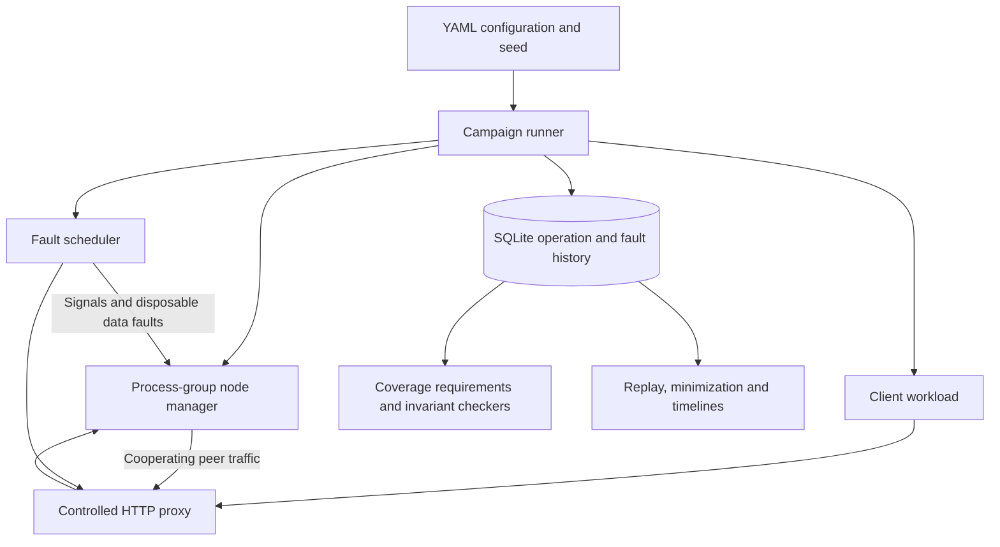

# FailForge

[](https://github.com/Yumekaz/FAILFORGE/actions/workflows/verification.yml)

**A local fault-injection framework for finding and reproducing distributed-system failures.**

FailForge starts process clusters, drives HTTP workloads, schedules faults, records execution histories and checks invariants. Failed campaigns can be replayed and minimized; terminal, Mermaid and HTML timelines make the fault/operation sequence inspectable.

Seeds reproduce **generated fault schedules**, not an identical OS-level execution. Process scheduling, I/O and network timing can still vary.

## What it does

- Launches local nodes in separate process groups.
- Routes participating HTTP requests through a controlled proxy.
- Injects seeded or scripted process, network, filesystem and cooperative clock faults.
- Records fault attempts, confirmed injections, failures and workload outcomes.
- Checks acknowledged-write visibility, lock exclusivity and leader uniqueness where configured.
- Replays and minimizes failing histories rather than treating every failure as unexplained noise.

It is a controlled local testing tool, not a production chaos service, raw TCP interceptor or formal verifier.

## Quick start

Requirements: Go **1.26.4 or a compatible newer toolchain**, Python 3 for the bundled example node, and a local host supporting the configured process signals. Use disposable target data directories.

```bash
git clone https://github.com/Yumekaz/FAILFORGE.git
cd FAILFORGE
mkdir -p bin
go build -o bin/failforge ./cmd/failforge
./bin/failforge run failforge.yml --seed 42
```

The default configuration uses `runs/42` for this seed. The command prints the actual output directory and returns nonzero if its checks fail. For repeated attempts that must not share that directory, change the YAML output to:

```yaml
output:
  dir: "runs/{seed}-{run_id}"
```

Inspect the printed run directory:

```bash
./bin/failforge report "<run-directory>"
./bin/failforge timeline "<run-directory>"
./bin/failforge timeline "<run-directory>" --html
./bin/failforge minimize "<failed-run-directory>"
```

The HTML timeline is written to `<run-directory>/timeline.html`. Its history and styling are bundled; Mermaid rendering currently loads a CDN script, so fully offline diagram rendering is not guaranteed.

## Architecture



Only traffic actually sent through the proxy is intercepted. Node-to-node routing and virtual clock skew require cooperation from the target adapter.

## Fault catalog

| Category | Types |
| --- | --- |
| Process | kill_node, restart_node, cpu_pause, slow_disk |
| Network | partition, asymmetric_partition, delay_messages, drop_messages, duplicate_messages, corrupt_messages, heal |
| Filesystem | disk_write_loss, partial_persistence, stale_snapshot_restart |
| Logical | clock_skew |

`cpu_pause` uses SIGSTOP/SIGCONT. `slow_disk` approximates stalls through process pauses; it is not block-device latency emulation. Filesystem faults can truncate or replace target data. Never point a campaign at unrelated files or a live production data directory.

## Interpret a result

A meaningful campaign needs successful operations and evidence that the intended fault actually happened. First-party fault profiles require both; requesting an injection is not sufficient.

Timeline events distinguish:

- `FaultAttempted`: an injection was requested.
- `FaultInjected`: the injector confirmed successful execution.
- `FaultInjectionFailed`: the injection or later fault operation failed.

The `read_after_acknowledged_write` checker accounts for overlapping write attempts and indeterminate failed writes. It does not impose response-arrival order on concurrent writes or claim complete linearizability verification. Failed/time-out writes may have partially applied.

Keep the seed, configuration, source revisions, operation history, fault evidence and coverage result together. Preserve intermittent failures and rerun their saved reproduction; a passing seed does not prove every schedule safe.

## First-party targets

| Target | Profile | Coverage |
| --- | --- | --- |
| [MiniDB](https://github.com/Yumekaz/Mini-Redis-Cassandra) | failforge_minidb.yml | Acknowledged-write/read behavior |
| [Coordination-service](https://github.com/Yumekaz/Coordination-service) | failforge_coordination.yml | Lock exclusivity and leader uniqueness |
| Coordination baseline | failforge_coordination_baseline.yml | Successful operations without injected faults |

Use sibling checkouts, or configure `MINIDB_ROOT` / `COORD_ROOT` as supported by the profiles. Coordination needs its Python requirements installed.

```bash
./bin/failforge run failforge_minidb.yml --seed 42
./bin/failforge run failforge_coordination_baseline.yml --seed 42
./bin/failforge run failforge_coordination.yml --seed 42
```

These profiles include `{run_id}` in their output/data directories; this is different from the bundled default's `runs/{seed}` layout. Their ports are configured independently to avoid cross-campaign fixture contamination.

## Write an adapter

Start with a [first-party profile](failforge_minidb.yml) and adapt:

1. The process command, node count, private ports and disposable data directory.
2. The workload's HTTP contract and applicable checkers.
3. Cooperative peer routing through `X-FailForge-From` / `X-FailForge-To`.
4. Virtual time handling through `X-FailForge-Clock-Offset`, if clock faults are used.
5. Successful-operation and confirmed-fault requirements.

The framework does not automatically intercept arbitrary protocols or turn an unmodified application into a clock-skew-aware target.

## Verification

Run a bounded first-party seed matrix with independent repetitions:

```bash
go build -o failforge ./cmd/failforge
./failforge hardening --output-dir "$PWD/validation-runs/new-campaign" \
  --profiles minidb,coordination --seeds 42..43 --repetitions 2 \
  --max-runs 8 --max-runtime 10m --run-timeout 90s --keep-going
```

The output directory is single-use. Each attempt retains its command, seed,
exit code, source fingerprints, confirmed faults, successful-operation counts,
violations and checksummed artifacts. Source changes invalidate that attempt;
freeze target revisions before running a release campaign. Repetitions are
separate observations, not retries that replace failures. Without `--keep-going`,
the matrix stops at its first non-passing attempt and records unstarted work.

Timeouts, interrupted runs, missing coverage and failed fault injection/recovery
are non-green, even if another fault succeeded. Storage thresholds are sampled
stop conditions, not a filesystem quota; an inherited per-file limit and bounded
cleanup add containment. Seeded schedules do not imply identical OS execution.

```bash
go test ./...
```

The required [Verification workflow](.github/workflows/verification.yml) builds the CLI, runs the framework suite and exercises pinned first-party targets: MiniDB seeds 42/43, Coordination's baseline and Coordination seeds 42/43. Covered local acceptance results are recorded in [Cairn's validation record](https://github.com/Yumekaz/Cairn/blob/main/docs/VALIDATION_2026-10.md).

[targets.lock](targets.lock) identifies the target source revisions used by CI. FailForge is connected to the [Cairn stack](https://github.com/Yumekaz/Cairn/blob/main/docs/STACK.md) as a verification project, not a production runtime dependency.
